# Pure Home — Showcase

An interactive workforce and service management platform showcase featuring customer management, scheduling, dashboards, and analytics.

> **Portfolio demonstration.** This repository is an independent showcase of the Pure Home product. It is **not** the company's production application. All customers, technicians, visits, and metrics are fictional and generated in the browser. The app has no backend and makes no network requests.

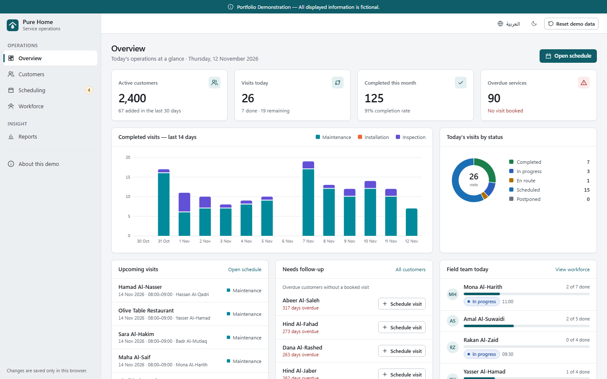

## What this showcase demonstrates

Pure Home supports a home water-treatment service business: customers on maintenance plans, a dispatch team that books visits, and field technicians who carry them out. The showcase rebuilds the main workflows as a self-contained front-end so you can try them without an account:

| Module | What you can do |
| --- | --- |
| **Overview** | KPIs for active customers, today's visits, monthly completion and overdue services; a 14-day trend chart, today's status mix, upcoming visits, a follow-up queue, and live field-team progress. |
| **Customers** | Search, filter (service status, zone, segment), sort and page through 2,400 fictional customers. Add a customer with validation. |
| **Customer profile** | **Previous service vs Next service** side by side, a full service-history timeline, and one-click booking of the next visit. |
| **Scheduling** | A weekly dispatch board (technicians × days). Drag a visit to another day or technician to reschedule it. Book visits, change status, assign unassigned requests, and use an agenda view on small screens. |
| **Workforce** | Technician cards with today's load, booked hours, rating and on-time rate. Each technician's route has a field checklist that drives visit status from *en route* to *in progress* to *completed*. |
| **Reports** | Period, zone and service-type filters; monthly volume (stacked bars with a data-table toggle), outcome breakdown, completion rate, zone ranking, a technician performance table, and **CSV export** generated locally. |
| **Localization** | Full **Arabic / English** support with a mirrored **RTL / LTR** layout, including charts. Gregorian dates and Latin digits are used in both languages. Light and dark themes are included. |

### How "previous" and "next" service are defined

- **Previous service** is the most recent visit that was actually *completed* on or before today. Cancelled or postponed visits never count as service.
- **Next service** is the earliest *open* booking (scheduled, en route or in progress) from today onward. If nothing is booked, the date is shown as a **projection** from the customer's maintenance cycle and labelled as such, so it is never mistaken for a commitment.
- **Service status** is derived from these: *Booked*, *Overdue* (projection in the past), *Due soon* (within 30 days), or *On track*.

These rules are written for this demo (`src/domain/service.ts`) and covered by unit tests.

### Scheduling rules enforced in the demo

Bookings and reschedules are validated against the local dataset. The checks are: no past dates, no visits on the weekly rest day (Friday), visits must fit within 08:00–18:00, and a technician cannot be double-booked. Every change is recorded in the visit's activity history.

## Screenshots

| | |
| --- | --- |
| 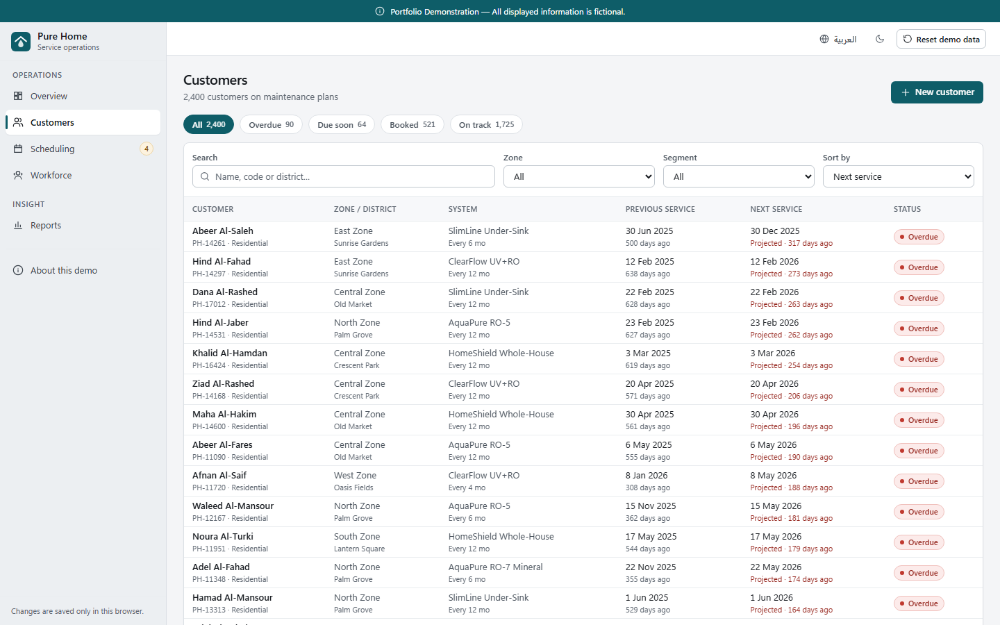 | 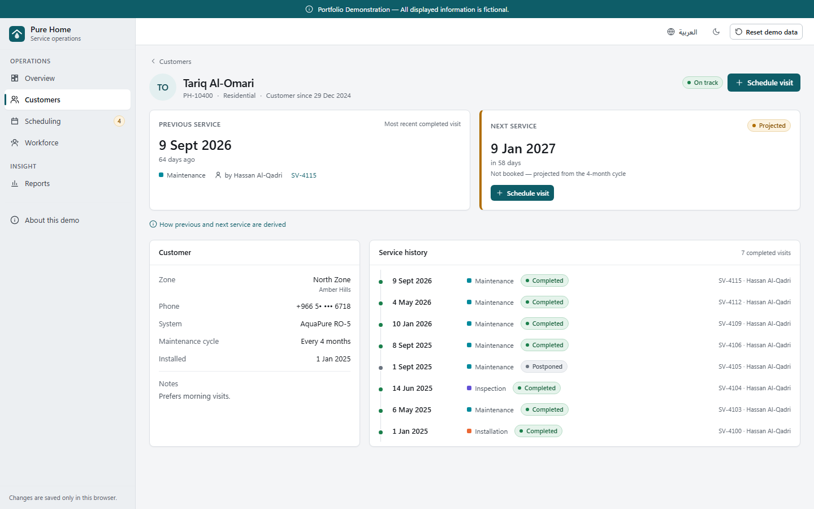 |
| 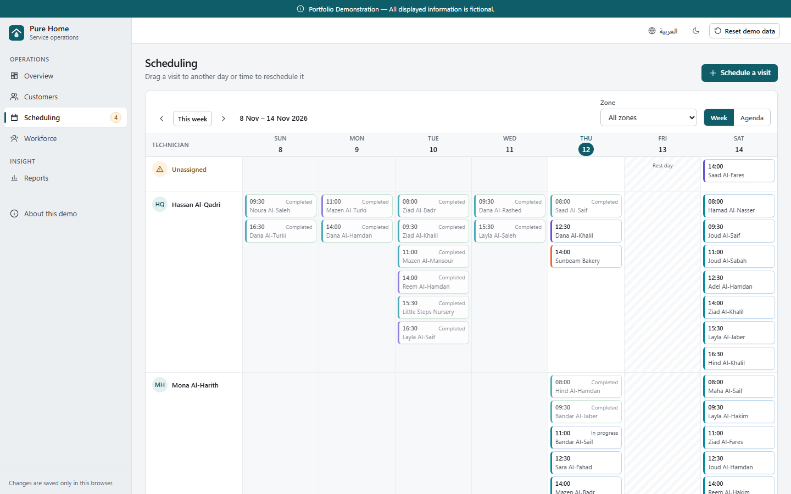 | 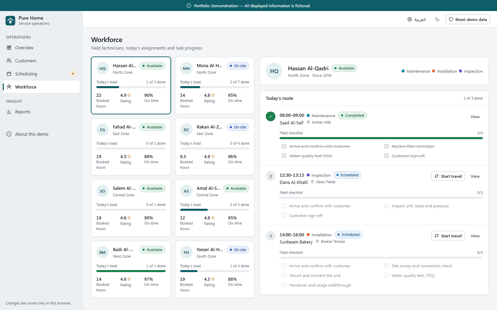 |
| 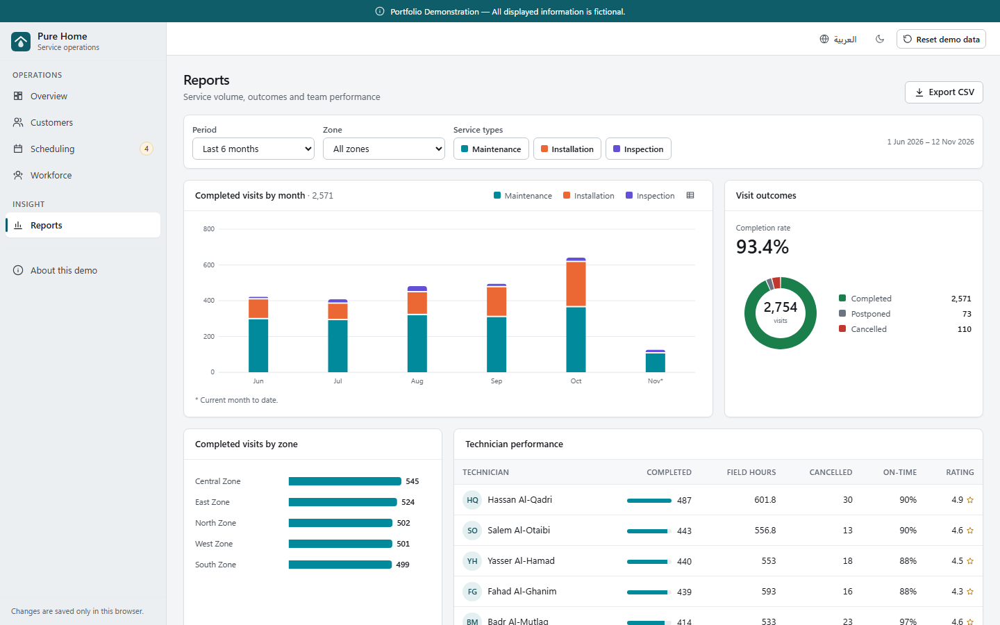 | 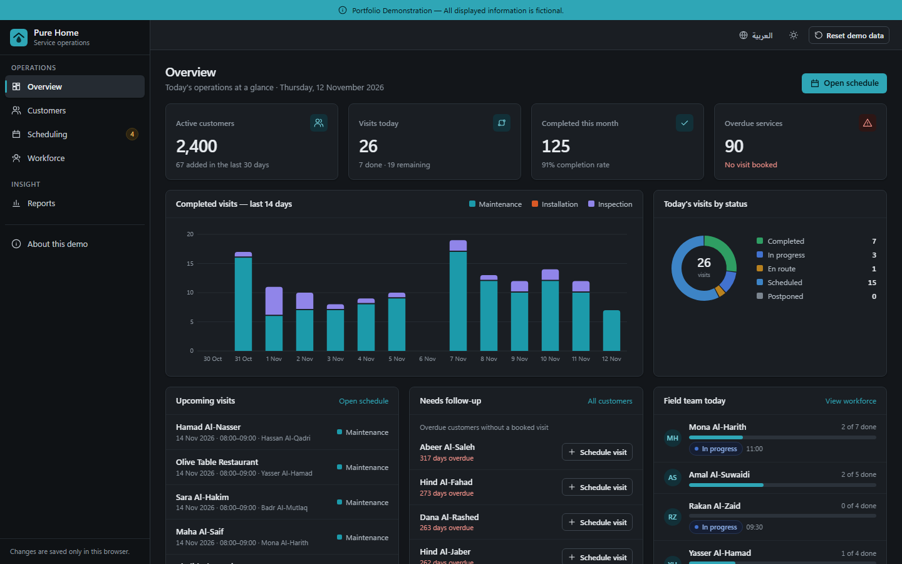 |
| 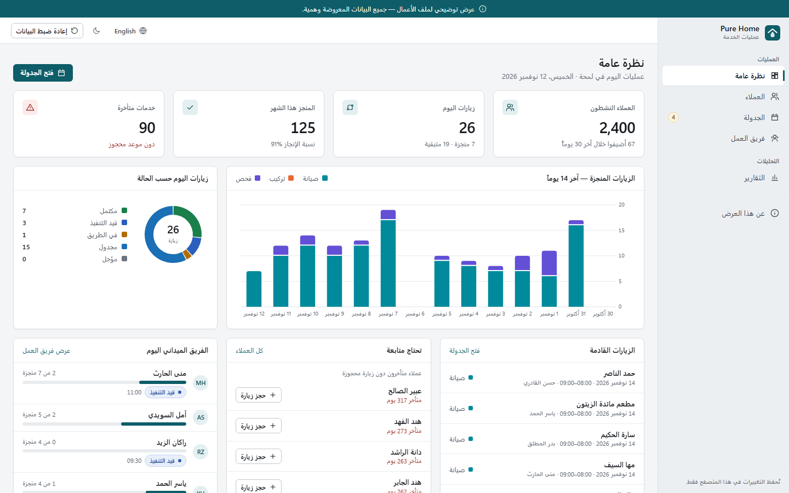 | 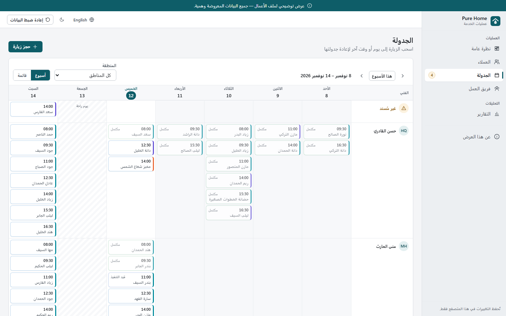 |

<p>
  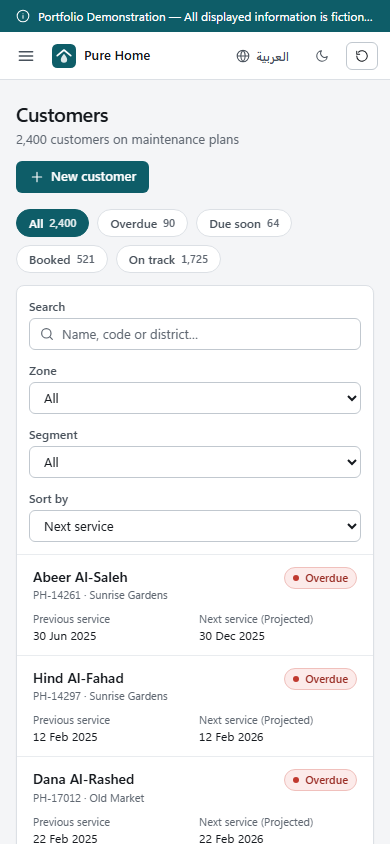
  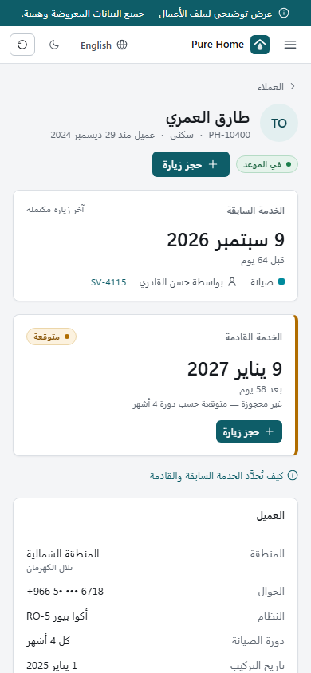
</p>

## Technology

- **React 18** + **TypeScript** (strict) + **Vite 6**
- **React Router 7** for routing
- **Tailwind CSS**, bound to CSS custom-property design tokens (light/dark themes, logical properties for RTL)
- **Hand-built SVG charts** (no chart library), with hover tooltips, keyboard focus, RTL mirroring and a colour-blind-checked palette
- **Vitest** for domain and isolation tests; **Playwright** for end-to-end, responsive, RTL and network-isolation tests
- Runtime dependencies are limited to `react`, `react-dom` and `react-router-dom`

## Architecture

```
src/
  domain/     Pure, framework-free logic: types, dates, previous/next service,
              slot validation, report aggregation, CSV encoding
  data/       catalog.ts (invented vocabulary), seed.ts (deterministic generator),
              ops.ts (operation log), store.tsx (React provider and actions)
  i18n/       English and Arabic dictionaries with typed keys and RTL handling
  ui/         Design-system primitives, icons, SVG charts, toasts, dialogs
  features/   Shared flows: booking/reschedule dialog, visit detail, customer form
  pages/      Overview, Customers, Customer profile, Scheduling, Workforce, Reports, About
```

**Mock data layer.** On load, `generateDemoData(today, seed)` builds the full dataset relative to the current date, so the schedule and dashboard always look current. The generator uses a seeded PRNG and produces identical output for the same seed and day. It creates 2,400 customers, 8 technicians and roughly 8,000 visits.

**Persistence without a backend.** Visitor changes (new customers, bookings, reschedules, status and checklist updates) are validated, then recorded as small operations. Only that operation log is saved to `localStorage`. On reload the dataset is regenerated and the log is replayed. A dataset fingerprint ensures a log is never applied to records it was not recorded against. **Reset demo data** clears the log instantly, and a new day starts fresh automatically.

**Offline by design.** The production build ships a Content-Security-Policy with `connect-src 'none'`, so the browser itself blocks any `fetch`, XHR, WebSocket or beacon. Lint rules forbid network APIs in `src/`, and tests assert that no request ever leaves the page.

## Getting started

Requirements: Node.js 22.12+ (or 24+). The app itself builds on Node 20, but the test runner (Vitest 5) needs 22.12+.

```bash
npm install
npm run dev        # http://localhost:5173
```

Production build and preview:

```bash
npm run build
npm run preview    # http://localhost:4173
```

## Quality checks

```bash
npm run typecheck      # TypeScript, strict
npm run lint           # ESLint (includes the no-network rule)
npm test               # Vitest: domain rules, generator determinism, i18n parity, isolation
npm run test:e2e       # Playwright: smoke, RTL, responsive, workflows, CSP and network audit
npm run audit:public   # Scans the repo and dist/ for secrets, private references and PII patterns
npm run audit:history  # Same rules over every blob in git history, plus commit identities and refs
npm run screenshots    # Regenerates docs/screenshots with a fixed demo clock
```

Playwright needs a Chromium build once: `npx playwright install chromium`.

## Demo guide

1. **Scheduling.** Drag a visit to another day. Try dropping it onto a technician who is already busy at that time, and the move is rejected with the reason.
2. **Customers → Overdue.** Open a customer to compare *Previous* and *Next* service, then book the next visit. The status changes to *Booked*.
3. **Workforce.** Pick a technician who is *en route*, mark them arrived, and tick the checklist. The visit completes and the Overview updates.
4. Switch to **العربية** to see the full RTL layout.
5. **Reports.** Change the period or zone and export the visible visits to CSV.
6. Use **Reset demo data** at any time.

## Privacy and data disclaimer

- Every record is **synthetic**. Names are random pairings of common given and family names. Businesses, districts, zones and product names are invented. Phone numbers are stored masked (`+966 5• ••• 1234`) with random final digits. Ratings, on-time rates and other metrics are generated.
- No production data was used to create the dataset, not even with names changed.
- The showcase does not connect to any database, API, authentication service, storage or real-time server. What you type stays in your browser's `localStorage`.
- This repository contains independently written front-end code. It does **not** include the production backend, authentication or authorization, database schema, API contracts, deployment configuration, desktop installers, or any internal documentation.

## Demonstration vs production

| Showcase (this repository) | Production Pure Home (not included) |
| --- | --- |
| Front-end only, runs entirely in the browser | Full platform with server, database and authentication |
| Seeded fictional dataset, reset at will | Real operational records |
| Simplified visit lifecycle and validation rules written for the demo | Company-specific business rules and approval workflows |
| No sign-in, no roles | Department workspaces and access control |
| No messaging, notifications or installers | Real-time messaging, notifications, desktop distribution |

## License

No license has been selected yet. Until one is added, the default copyright rules apply.
